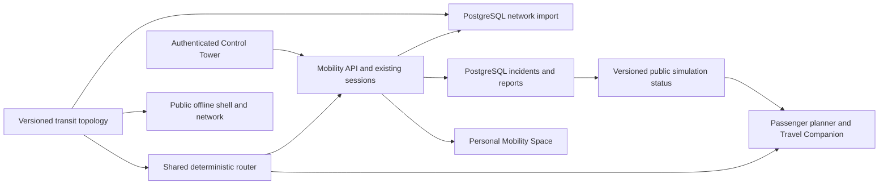

# Mobility architecture

## Routing

The planner and API share a graph with one node per line-specific station, two directed traversals of each ride or transfer edge, and stable ordering. Dijkstra compares lexicographic costs. Yen's algorithm returns up to three loopless alternatives. Estimated ride costs are 2.5 minutes per tram segment and 2 per busway segment. Walking transfers use an estimated 5 minutes. A delay adds 2 minutes per affected ride segment. The estimates exclude wait time.

Station closures block boarding, alighting and transfers. Vehicles can pass through. Segment closures block in both directions across the selected range. A line suspension disconnects the line. Accessibility restrictions exclude endpoints or transfers in accessibility-priority mode. Unknown accessibility stays visible in the result. Information alerts have no routing effect.

The passenger browser polls public status every four seconds while visible and every twelve seconds while hidden. A version contains the active incident IDs and revisions. The planner checks whether a changed effect intersects the current trip and recomputes against the newest snapshot. Travel Companion recalculates from the last manually confirmed station and waits for the passenger to accept the proposed route. An expired or resolved incident drops out of the next snapshot.

## Persistence and access

The migration and import reuse CasaMove's pool and are lazy and transactional. An advisory lock serialises competing imports. A network version stores the full immutable topology. A station registry supplies foreign keys without deleting IDs referenced by earlier records. The remaining tables store incidents and incident history, structured reports, saved journeys, favourites, user preferences, consented completion history and notification read receipts.

An incident and its audit snapshot commit together. Edits and resolution require the revision currently held by the caller. Passenger reports are account-owned, deduplicated for 15 minutes, and limited to eight distinct submissions an hour per account. Reports in the same station and category are grouped for moderation within two hours on either side of the observation. A report or report group never changes routing constraints by itself.

The existing session authorises all private reads and writes. Only admins can mutate incidents and moderate reports. Simulation is scoped to the running deployment, so two separate browser sessions against that deployment can follow it. There is no official incident ingestion. The public status contains no account IDs. Unpublished incident text stays in the protected dashboard, while its simulated effects remain available to the planner.

## Browser and offline behaviour

Public passenger pages have a production service worker. Its explicit allowlist covers localised home, planner and network pages, fingerprinted static assets, the public topology and icons. Account, admin, incident status, sign-in and mutation responses bypass the cache. Travel progress and recent station IDs live in tab session storage and are cleared on account sign-out. The browser stores only the timestamp of the last public status check across a tab reload. An offline reload uses the bundled topology and displays a stale-data status.

Advance the cache version in `public/sw.js` when releasing a changed offline shell. The browser activates a waiting worker after the old worker's tabs close.

Code under `lib/mobility` has no dependency on LangGraph, RAG, NVIDIA or agent memory. Existing subscription and complaint reads remain account-scoped. The operations console uses complaint counts from existing persisted records.
